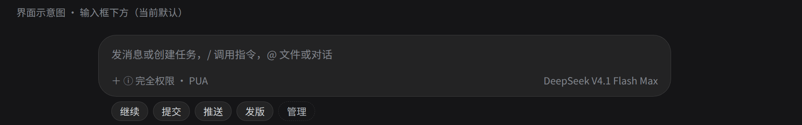
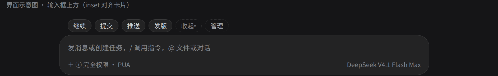
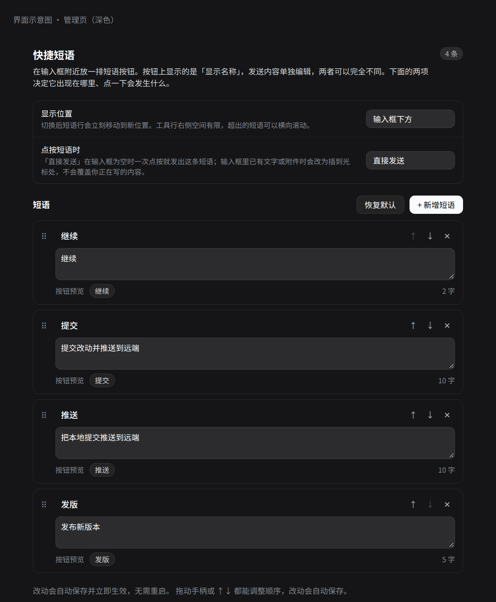

# dsh-quick-phrases

[](https://github.com/pengtang1024/dsh-quick-phrases/actions/workflows/ci.yml)
[](https://github.com/pengtang1024/dsh-quick-phrases/releases)
[](https://www.npmjs.com/package/dsh-quick-phrases)
[](LICENSE)

给 DeepSeek Harness（DSH）的输入框加一排快捷短语按钮：`继续`、`提交`、`推送`、`发版` 这类天天要打的字，点一下就送进输入框或直接发出。按钮上显示的**名称**和真正发出的**内容**分开编辑，所以按钮可以很短，话可以很长。

> Composer decoration for DeepSeek Harness: a row of quick-phrase chips whose captions and sent text are edited separately, plus a management page in Settings.



## 功能

- **一排短语按钮**：显示名称与发送内容分离，默认四条：继续 / 提交 / 推送 / 发版。
- **点按行为可选**：默认「直接发送」——输入框为空时一次点按就发出；输入框里已有文字或附件时，任何模式都改为插到光标处，不会覆盖正在写的内容。
- **显示位置可选**：输入框下方（默认）、输入框上方、工具行右侧，切换即时生效。
- **管理页**：拖动手柄排序、直接在卡片上改名、实时按钮预览与字数、两步确认删除、一键恢复默认。
- **零依赖**：纯前端一个 `client.js`，不联网、不读写文件、不引入 npm 包，数据只存在本机 `localStorage`。

## 安装

前置：DSH 桌面端或 Web 端（0.2.2 及以上）。插件没有运行时依赖，也没有构建步骤。

**方式 A（npm，推荐）**

```bash
dsh plugin --profile <你的 profile> add dsh-quick-phrases
```

装完重启 DSH（或在会话页按 `Ctrl+R`）。包已发布到 npm：[dsh-quick-phrases](https://www.npmjs.com/package/dsh-quick-phrases)，升级时把 `add` 换成 `update dsh-quick-phrases` 即可。

**方式 B（插件市场）**

在 DSH 里打开 **Plugins → Discover → Index sources**，添加本仓库的索引地址：

```
https://cdn.jsdelivr.net/gh/pengtang1024/dsh-quick-phrases@main/index.json
```

之后在 Discover 里搜索「快捷短语」即可看到本插件与版本，点安装走的就是 `plugin_manager`。

**方式 C（本地目录）**

Plugins → Add plugin → 选择本仓库目录；或让 DSH 里的 agent 执行 `plugin_manager install_bundle target=/path/to/dsh-quick-phrases`。本地目录安装是 `link:` 方式，改完 `client.js` 只需重载页面、不必重装。

> 三种方式装的是同一个 bundle，不要同时装两份：用 npm 或市场装过之后，先把本地 `link:` 那份卸掉再换。

## 使用

### 放在哪里

| 位置 | 插槽 | 说明 |
| --- | --- | --- |
| 输入框下方（默认） | `conversation.composer.dock` | 常驻在输入卡片下方的一整行，最宽松。 |
| 输入框上方 | `conversation.input.dock` | 卡片上方一整行；宽度与居中按宿主 dock 几何计算，和卡片文字内边对齐。 |
| 工具行右侧 | `conversation.input.right` | 挤进输入框底部工具行；空间有限，超出部分横向滚动。 |



### 管理页

设置 → **快捷短语**：上面两个下拉框决定位置与点按行为，下面一条短语一张卡片。



- 拖动左侧 `⠿` 手柄排序，或用 `↑` / `↓` 一格一格挪；列表顺序就是按钮的从左到右顺序。
- 卡片顶部那行是**显示名称**，直接点进去改；下面大框是**发送内容**。
- 卡片底部实时显示按钮预览和字数，名称太长一眼就能看出来。
- `✕` 第一次只进入「确认」态（4 秒后自动撤回），再点一次才真正删除。
- **新增短语**会追加空卡片并聚焦名称；**恢复默认**在左侧，点一次进入确认态，再点一次恢复内置四条。

英文界面同样可用（跟随 DSH 界面语言）。

## 数据与隐私

短语、位置、点按行为分别存在 `localStorage` 的三个键里：

| 键 | 内容 |
| --- | --- |
| `dsh.quick-phrases.v1` | 短语列表（`id` / `label` / `text`） |
| `dsh.quick-phrases.placement.v1` | 显示位置 |
| `dsh.quick-phrases.click.v1` | 点按行为 |

按 DSH Web 端的站点存储隔离；换机器或清空站点数据会丢。插件没有网络请求、没有 `eval`、不读写文件，也不向 Host 注册任何服务。

## 开发

```bash
node --check client.js            # 语法
node test/smoke.mjs               # 行为测试：假 React + 真 client.js，无依赖
node test/preview.mjs             # 把真实组件渲染成 /tmp/*.html（深色/浅色）
node test/preview.mjs --shot      # 再用无头 Chromium 截图
```

`preview.mjs` 默认从 Playwright 缓存里找 Chromium，可用 `DQP_CHROME=/path/to/chrome` 覆盖；主题 token 从宿主 `app.asar` 读取，可用 `DQP_ASAR` 覆盖（找不到时仍会输出未着色 HTML）。

目录结构：

```
client.js          客户端插件全部逻辑（ModuleLoader 工厂 + 三个插槽组件）
index.js           Host 侧空壳（export function apply() {}）
cordis.patch.yml   bundle 插入行
locale/{zh,en}.json 插件管理器里的标题/描述/详情
docs/DETAIL*.md    中英文使用说明（插件详情页展示）
docs/ARCHITECTURE.md 实现说明：插槽、数据层、样式与测试
test/smoke.mjs     行为测试
test/preview.mjs   预览与截图
```

## 文档

- [使用说明（中文）](docs/DETAIL.md) · [Usage (English)](docs/DETAIL.en.md)
- [实现说明](docs/ARCHITECTURE.md)
- [变更记录](CHANGELOG.md)
- [贡献指南](CONTRIBUTING.md) · [安全策略](SECURITY.md) · [行为准则](CODE_OF_CONDUCT.md)

## 许可证

[MIT](LICENSE) © 2026 pengtang1024
